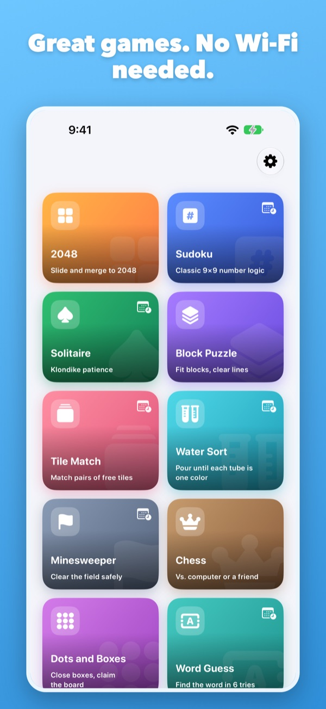
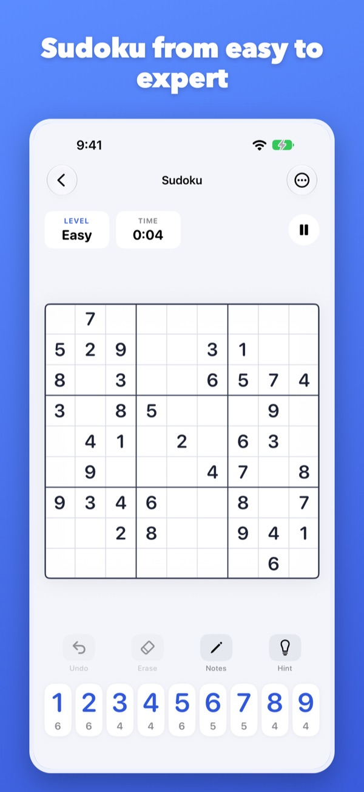
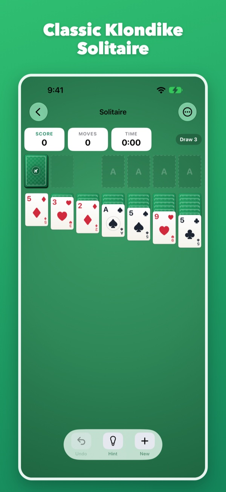
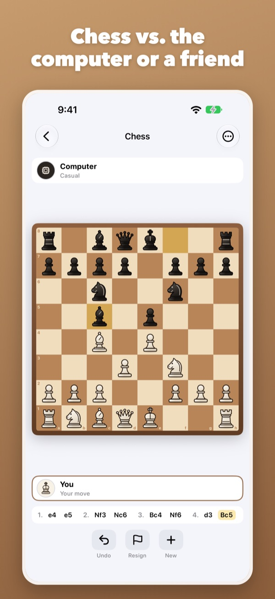
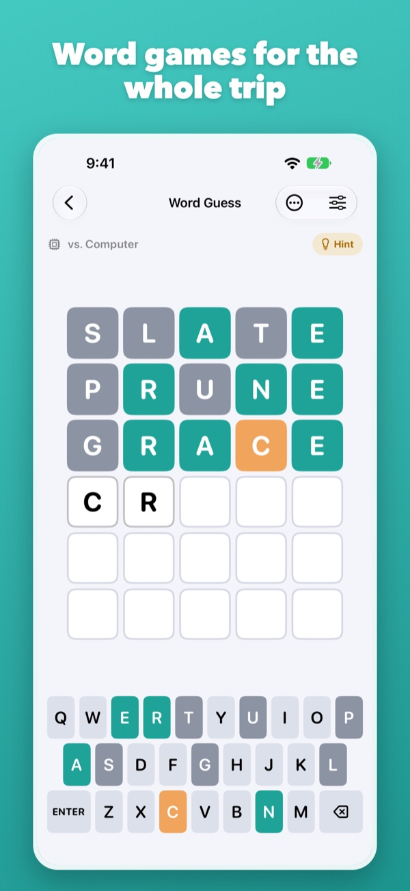
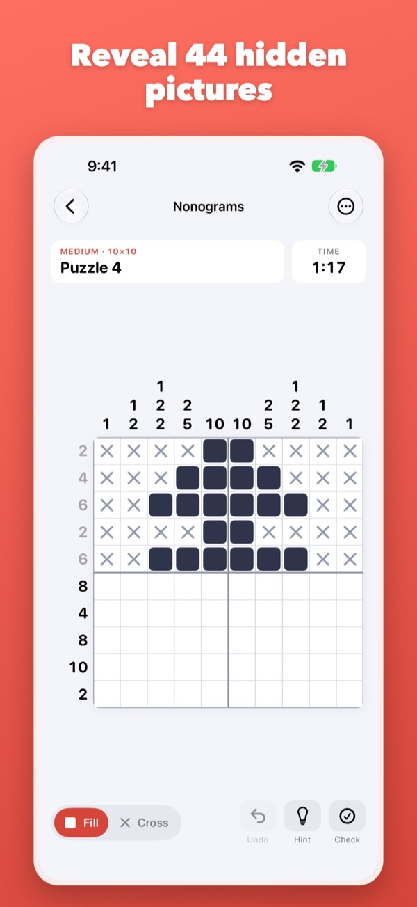
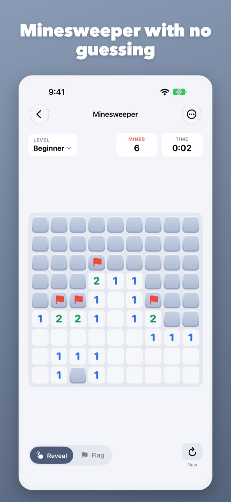
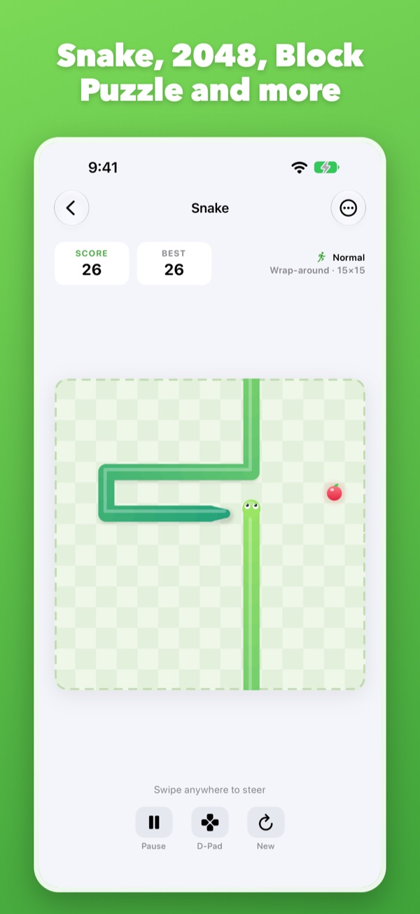
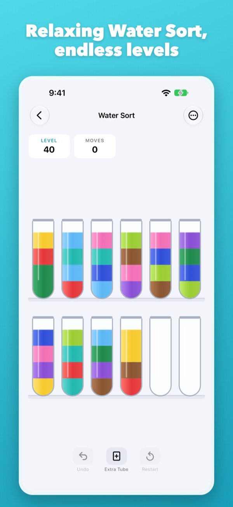
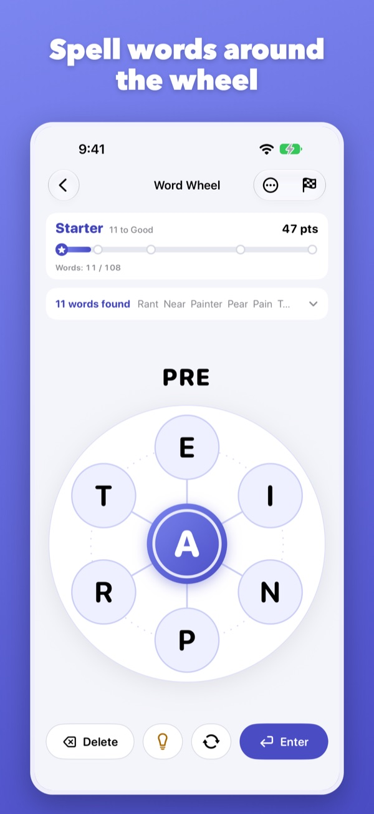

# Airplane Games ✈️

**Beautifully made games that work completely offline.**
Made for long flights, train rides and anywhere without Wi‑Fi. Free, with no ads,
no accounts, no in-app purchases and no tracking.

  

For iPhone and iPad.

  
  
  
  
  
  
  
  
  
  

## The games

| Game | |
|------|---|
| **2048** | Slide and merge tiles, with undo |
| **Sudoku** | Four difficulty levels, notes, and hints that explain the next step |
| **Solitaire** | Classic Klondike, draw 1 or draw 3, with auto-complete |
| **FreeCell** | Every card face up and every deal winnable, with hints that find the way |
| **Block Puzzle** | Fit blocks on the board and clear rows and columns |
| **Tile Match** | Match pairs of free tiles across six original layouts |
| **Water Sort** | Pour until every tube holds one color, with endless levels |
| **Minesweeper** | Every board solvable by logic, never a 50/50 guess |
| **Chess** | Play the computer at five levels, or a friend on the same device |
| **Dots and Boxes** | Close the most boxes, against the computer or a friend |
| **Word Guess** | Find the five-letter word in six tries |
| **Word Wheel** | Make words from seven letters around a center letter |
| **Nonograms** | 44 original picture puzzles, all solvable by logic |
| **Word Search** | 15 themes in three sizes |
| **Snake** | Four speeds, three board sizes, walls or wrap-around, swipe or D-pad |
| **Hangman** | A friendly hot-air balloon version, with categories |

Every game saves automatically, works in light and dark mode, and supports VoiceOver.
Games with an opponent can be played against the computer or a friend on the same device.

## Private by design

Airplane Games has no network access at all. It collects no data, shows no ads and has
no accounts. Your games and statistics never leave your device.
[Privacy policy](privacy/).

## Help and feedback

Found a bug or have an idea? [Open an issue on GitHub](https://github.com/guilhermechapiewski/airplane-games-app/issues).

## Open source

Airplane Games is free and open source under the MIT license:
[github.com/guilhermechapiewski/airplane-games-app](https://github.com/guilhermechapiewski/airplane-games-app).
